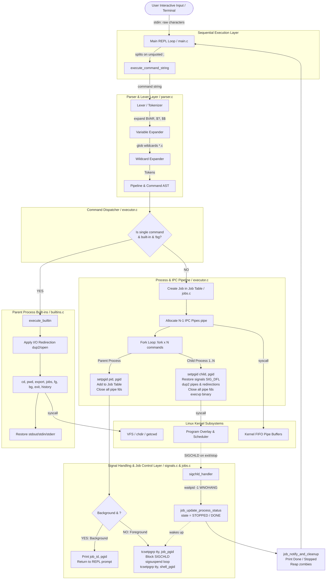

# Mini Linux Shell (`mysh`) - Architecture Specification

> **Course**: Operating Systems Lab (24B11CS312), JIIT Noida  
> **Topic**: Architectural Design, Inter-Module Dataflow & Kernel Subsystem Interactions  

---

## 1. High-Level Architectural Flowchart



---

## 2. ASCII Architectural Diagram

```
+========================================================================================+
|                                USER TERMINAL / TTY                                     |
+========================================================================================+
         |                                                               ^
         | [stdin: Keyboard / Script]                                    | [stdout / stderr]
         v                                                               |
+----------------------------------------------------------------------------------------+
| 1. MAIN REPL & DISPATCHER (main.c)                                                     |
|    - Initializes terminal job control (tcgetpgrp, setpgid, tcsetpgrp)                  |
|    - Loops getline() while harvesting background jobs via job_notify_and_cleanup()     |
|    - Splits commands chained by semicolons (;) outside quotes                          |
+----------------------------------------------------------------------------------------+
         |
         v
+----------------------------------------------------------------------------------------+
| 2. LEXER, EXPANDER & PARSER (parser.c)                                                 |
|    - Tokenizes words, operators (|, <, >, >>, 2>, &)                                   |
|    - Handles single quotes ('...') and double quotes ("...")                           |
|    - Expands environment variables ($HOME, $USER, $?, $$)                              |
|    - Expands path wildcards (*, ?) using POSIX glob()                                  |
|    - Generates Pipeline & Command Abstract Syntax Trees (AST)                          |
+----------------------------------------------------------------------------------------+
         |
         +-------------------------------------+
         |                                     |
         | (Single Built-in & !bg)             | (External Command / Pipeline / Background)
         v                                     v
+---------------------------------+  +---------------------------------------------------+
| 3. BUILT-IN EXECUTOR            |  | 4. PIPELINE ORCHESTRATOR (executor.c)             |
|    (builtins.c)                 |  |    - Creates Job entry in job table               |
|    - Runs in SHELL PROCESS      |  |    - Allocates N-1 pipes via pipe()               |
|    - cd [dir] / cd -            |  |    - Forks N child processes                      |
|    - pwd                        |  |    - Connects pipeline stages with dup2()         |
|    - export VAR=val             |  |    - Applies <, >, >>, 2> file redirections       |
|    - exit [code] (warn stopped) |  |    - Closes ALL unused pipe descriptors           |
|    - jobs, fg [%n], bg [%n]     |  |    - Replaces child process images via execvp()   |
+---------------------------------+  +---------------------------------------------------+
         |                                     |                         |
         |                                     | [Foreground]            | [Background (&)]
         |                                     v                         v
         |                           +--------------------+    +-------------------------+
         |                           | 5. FOREGROUND WAIT |    | 6. BACKGROUND RUNNER    |
         |                           |    - tcsetpgrp()   |    |    - Shell retains tty  |
         |                           |    - sigsuspend()  |    |    - Prints [id] pgid   |
         |                           |    - tcsetpgrp()   |    |    - Prompt immediately |
         +---------------------------+----+---------------+----+-------------------------+
                                                  |
                                                  v
+========================================================================================+
| 7. SIGNAL HANDLING & JOB CONTROL LAYER (signals.c & jobs.c)                            |
|    - Shell ignores SIGINT, SIGTSTP, SIGQUIT, SIGTTIN, SIGTTOU                          |
|    - Children restore SIG_DFL for all signals before execvp()                          |
|    - setpgid(pid, pgid) called in BOTH parent and child (prevents race condition)      |
|    - SIGCHLD handler reaps terminated/stopped children with waitpid(WNOHANG)           |
|    - sigprocmask() blocks SIGCHLD during job table manipulations                       |
|    - Zero zombies: all terminated children are systematically reaped                   |
+========================================================================================+
                                                  |
                                                  v
+========================================================================================+
|                                    LINUX KERNEL                                        |
|   [Process Manager]       [VFS / File Descriptors]         [IPC / Signal Subsystem]    |
+========================================================================================+
```

---

## 3. Subsystem Breakdown and Data Contracts

### 3.1 Data Structures Contract (`parser.h`)
```c
typedef struct Command {
    char **argv;        /* NULL-terminated argument vector for execvp() */
    int argc;           /* Argument count */
    char *input_file;   /* Target file for stdin redirection (<) */
    char *output_file;  /* Target file for stdout redirection (> or >>) */
    int append_output;  /* 1 if >> (O_APPEND), 0 if > (O_TRUNC) */
    char *error_file;   /* Target file for stderr redirection (2>) */
} Command;

typedef struct Pipeline {
    Command *commands;  /* Contiguous array of command stages */
    int num_commands;   /* Number of stages in pipeline */
    int background;     /* 1 if execution requested in background (&) */
    char *raw_input;    /* Preserved input string for job reporting */
} Pipeline;
```

### 3.2 Job Table Contract (`jobs.h`)
```c
typedef enum { JOB_RUNNING, JOB_STOPPED, JOB_DONE } JobState;

typedef struct Process {
    pid_t pid;          /* Operating system process ID */
    int status;         /* Raw exit status or stop signal code from waitpid */
    int completed;      /* 1 if process terminated (WIFEXITED / WIFSIGNALED) */
    int stopped;        /* 1 if process is suspended (WIFSTOPPED) */
    struct Process *next;
} Process;

typedef struct Job {
    int job_id;             /* 1-based sequential shell job identifier [1], [2] */
    pid_t pgid;             /* POSIX Process Group ID of the pipeline */
    char *command_line;     /* Preserved user-visible command description */
    Process *first_process; /* Linked list of child processes in the pipeline */
    int num_processes;      /* Total child process count */
    JobState state;         /* Aggregate state: RUNNING, STOPPED, or DONE */
    int is_foreground;      /* 1 if foreground job, 0 if background */
    int notified;           /* 1 if user has been notified of completion/stop */
    struct Job *next;       /* Linked list pointer */
} Job;
```

---

## 4. Key Design Patterns & Race Condition Preventions

1. **Dual `setpgid` Call Pattern**:
   - Both the child process and the parent process invoke `setpgid(pid, pgid)` immediately after `fork()`.
   - *Why*: Eliminates the scheduling race condition where the parent might attempt `tcsetpgrp()` or `waitpid(-pgid)` before the child has executed `setpgid()`, or where the child might execute `execvp()` before the parent updates its table.
2. **Atomic Signal Synchronization (`sigsuspend`)**:
   - In `wait_for_job()`, `SIGCHLD` is blocked with `sigprocmask()`, and the loop pauses via `sigsuspend(&old_mask)`.
   - *Why*: Prevents missed wakeups where a child terminates after the loop condition check but before the wait call.
3. **Async-Signal-Safe Status Updates**:
   - The `SIGCHLD` handler only reaps with `waitpid(-1, &status, WNOHANG | WUNTRACED | WCONTINUED)` and updates numeric status fields.
   - All console formatting (`printf`) and heap memory freeing (`free`) are deferred to `job_notify_and_cleanup()`, which runs safely in the main execution thread.
4. **Universal File Descriptor Closure**:
   - Both ends of every pipe are closed in the parent immediately after all children are forked.
   - Each child duplicates the required read/write ends to `STDIN_FILENO` / `STDOUT_FILENO` and closes all other pipe descriptors.
   - *Why*: Prevents pipeline deadlock where children hang indefinitely waiting for EOF on open read descriptors.

