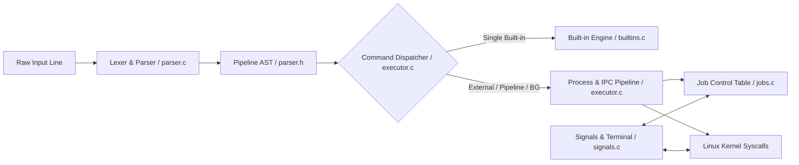

# Operating Systems Lab Project Report: Mini Linux Shell (`mysh`)

**Course**: Operating Systems Lab (Course Code: 24B11CS312)  
**Institution**: Jaypee Institute of Information Technology (JIIT), Noida  
**Project Title**: Mini Linux Shell with Process and Job Control  
**Implementation Language**: C (C11, POSIX `_POSIX_C_SOURCE 200809L`)  
**Target Environment**: Linux (Ubuntu 20.04 / 22.04 / 24.04 LTS)  

---

## 1. Introduction

A command-line interpreter (shell) is the primary user-interface program in Unix-like operating systems. It acts as an intermediary between the user and the kernel, parsing user command strings, executing programs, orchestrating inter-process communication, and managing execution states.

This project implements `mysh`, a complete, functional mini Linux shell designed to provide deep practical insight into systems programming concepts taught in the OS curriculum, including process lifecycle management, process groups, terminal job control, asynchronous signals, inter-process communication via pipes, and file descriptor redirection.

---

## 2. Problem Statement & Objectives

### 2.1 Problem Statement
Modern operating systems manage concurrent applications through process abstraction, resource protection, and signal mechanisms. Designing a command-line interpreter requires solving complex systems-level challenges:
1. Creating isolated execution environments for programs without corrupting the parent process.
2. Managing process groups so keyboard signals affect the foreground pipeline without terminating the shell.
3. Managing non-blocking asynchronous event notifications without race conditions or process table saturation (zombie processes).
4. Duplicating and connecting arbitrary I/O streams using kernel IPC channels.

### 2.2 Objectives
- Build an interactive shell adhering strictly to POSIX standards in C11.
- Implement process creation and binary overlay via `fork()` and `execvp()`.
- Implement parent-resident built-in commands (`cd`, `pwd`, `export`, `exit`, `jobs`, `fg`, `bg`, `history`, `help`).
- Implement file descriptor redirection for stdin (`<`), stdout (`>`, `>>`), and stderr (`2>`).
- Implement arbitrary N-stage IPC pipelines (`cmd1 | cmd2 | ... | cmdN`).
- Implement full POSIX job control: background execution (`&`), process groups (`setpgid`), terminal ownership (`tcsetpgrp`), and signal handlers (`SIGINT`, `SIGTSTP`, `SIGCHLD`).
- Guarantee memory safety and zero memory leaks under Valgrind and AddressSanitizer.
- Deliver an automated verification test suite with 100% pass rate.

---

## 3. Architecture & Modular Decomposition

The architecture of `mysh` follows a modular pipeline design, isolating lexical analysis, execution dispatch, process table management, and signal coordination.



### Module Responsibilities:
1. **Input Reader & REPL Loop (`main.c`)**: Manages the Read-Eval-Print Loop, terminal initialization, semicolon command splitting, and background job completion harvesting before each prompt.
2. **Lexer, Tokenizer & Parser (`parser.c`, `parser.h`)**: Scans user input, respects single quotes (`'...'`) and double quotes (`"..."`), expands environment variables (`$VAR`, `$?`, `$$`), performs wildcard globbing (`*.c`), and constructs the `Pipeline` Abstract Syntax Tree (AST).
3. **Execution Engine (`executor.c`, `executor.h`)**: Orchestrates child process creation, pipeline creation (`pipe`), descriptor duplication (`dup2`), unused descriptor closure, and foreground status synchronization (`sigsuspend`).
4. **Built-in Command Engine (`builtins.c`, `builtins.h`)**: Executes parent-resident commands (`cd`, `pwd`, `export`, `exit`, `jobs`, `fg`, `bg`, `history`, `help`) with redirection support.
5. **Job Table & Process Manager (`jobs.c`, `jobs.h`)**: Maintains the active job list, tracking Process Group IDs (PGID), process list, states (`JOB_RUNNING`, `JOB_STOPPED`, `JOB_DONE`), and current (`+`) / previous (`-`) markers.
6. **Signal & Terminal Handler (`signals.c`, `signals.h`)**: Configures signal actions via `sigaction()`, coordinates atomic signal masks via `sigprocmask()`, and manages terminal foreground control via `tcsetpgrp()`.
7. **Utility Suite (`utils.c`, `utils.h`)**: Implements safe memory allocators (`safe_malloc`, `safe_realloc`, `safe_strdup`) and string formatting utilities.

---

## 4. Key System Calls & Their Rationale

| System Call | Prototype | Purpose in `mysh` |
|---|---|---|
| `fork()` | `pid_t fork(void)` | Creates a new child process with isolated address space to execute external commands. |
| `execvp()` | `int execvp(const char *file, char *const argv[])` | Replaces the child process image with the executable binary found in the `PATH` environment. |
| `waitpid()` | `pid_t waitpid(pid_t pid, int *status, int options)` | Synchronizes with child state changes; used with `WNOHANG` in `SIGCHLD` and `WUNTRACED` for job control. |
| `pipe()` | `int pipe(int pipefd[2])` | Allocates kernel FIFO buffer for inter-process communication between pipeline stages. |
| `dup2()` | `int dup2(int oldfd, int newfd)` | Duplicates file descriptors to redirect stdin, stdout, and stderr for pipelines and file I/O. |
| `open()` | `int open(const char *pathname, int flags, mode_t mode)` | Opens or creates redirection target files with flags (`O_RDONLY`, `O_WRONLY`, `O_CREAT`, `O_TRUNC`, `O_APPEND`). |
| `close()` | `int close(int fd)` | Releases file descriptors; critical for closing unused pipe ends to signal `EOF`. |
| `kill()` | `int kill(pid_t pid, int sig)` | Dispatches signals (`SIGCONT`, `SIGHUP`, `SIGTTIN`) to individual processes or process groups (`-pgid`). |
| `setpgid()` | `int setpgid(pid_t pid, pid_t pgid)` | Sets the process group ID of child processes, grouping pipeline commands together. |
| `tcsetpgrp()` | `int tcsetpgrp(int fd, pid_t pgrp)` | Transfers terminal foreground ownership between the shell and active child process groups. |
| `tcgetpgrp()` | `pid_t tcgetpgrp(int fd)` | Queries the foreground process group ID of the terminal to detect background launches. |
| `sigaction()` | `int sigaction(int signum, const struct sigaction *act, struct sigaction *oldact)` | Configures signal handling dispositions (`SIG_IGN`, `SIG_DFL`, handler functions) reliably. |
| `sigprocmask()` | `int sigprocmask(int how, const sigset_t *set, sigset_t *oldset)` | Atomically blocks and unblocks `SIGCHLD` to prevent race conditions during job table access. |
| `sigsuspend()` | `int sigsuspend(const sigset_t *mask)` | Atomically unblocks signals and pauses the shell waiting for child events without race conditions. |
| `chdir()` | `int chdir(const char *path)` | Changes the current working directory of the parent shell process. |
| `getcwd()` | `char *getcwd(char *buf, size_t size)` | Retrieves the absolute current working directory path for `pwd` and directory tracking. |

---

## 5. Signal Handling & Job Control Design

### 5.1 Process Group Isolation
In Unix, terminal input and keyboard signals (`Ctrl+C`, `Ctrl+Z`) are delivered exclusively to the **foreground process group**. If all child processes remained in the shell's process group, sending `SIGINT` would terminate both the child and the shell.

To prevent this:
1. Upon startup, the shell puts itself in its own private process group:
   ```c
   shell_pgid = getpid();
   setpgid(shell_pgid, shell_pgid);
   tcsetpgrp(STDIN_FILENO, shell_pgid);
   ```
2. When creating a pipeline, the first process becomes the group leader (`pgid = child_pid`). Subsequent processes in the pipeline join this process group.

### 5.2 Race Conditions Avoided
1. **The `setpgid` Scheduling Race**:
   If only the child calls `setpgid()`, the parent might execute `tcsetpgrp()` or `waitpid(-pgid)` before the child has completed `setpgid()`. If only the parent calls it, the child might call `execvp()` before `setpgid()`.
   **Fix**: Both the parent and the child call `setpgid(pid, pgid)` immediately after `fork()`.
2. **Foreground Wait / SIGCHLD Race**:
   If the shell checks `job_is_completed()` and calls `pause()`, a child might finish between the check and `pause()`, causing `pause()` to hang indefinitely.
   **Fix**: The shell blocks `SIGCHLD` before checking the loop condition and calls `sigsuspend(&old_mask)`, which atomically unblocks `SIGCHLD` and pauses the process.
3. **Deadlocks in Asynchronous Signal Handlers**:
   Functions like `printf()` and `malloc()` use non-reentrant locks. Calling them in `sigchld_handler` when the main thread was interrupted inside `malloc()` causes immediate deadlock.
   **Fix**: `sigchld_handler` is strictly **async-signal-safe**. It only reaps statuses with `waitpid()` and modifies primitive integers. Formatting and printing are deferred to `job_notify_and_cleanup()` in the main loop.
4. **Terminal Suspension on `tcsetpgrp` (`SIGTTOU`)**:
   Calling `tcsetpgrp()` from a background process group causes the kernel to suspend the process with `SIGTTOU`.
   **Fix**: The shell ignores `SIGTTOU` and `SIGTTIN` using `sigaction()` during terminal handover.

---

## 6. Testing Results & Verification

An automated verification suite (`tests/run_tests.sh`) comprising 22 tests was developed and executed.

### Test Execution Summary

| Test # | Category | Description | Result |
|---|---|---|:---:|
| 01 | Simple Commands | Simple `echo` execution compared with `bash` | **PASS** |
| 02 | Built-ins | `pwd` built-in prints working directory | **PASS** |
| 03 | Built-ins | `cd [dir]` and `cd -` (OLDPWD navigation) | **PASS** |
| 04 | Error Handling | Non-existent command reports error (exit code 127) | **PASS** |
| 05 | Syntax Errors | Syntax error detected: pipe at start of line (`\| ls`) | **PASS** |
| 06 | Syntax Errors | Syntax error detected: redirection without file (`cat <`) | **PASS** |
| 07 | Redirection | Output redirection (`>`) truncates file correctly | **PASS** |
| 08 | Redirection | Output redirection (`>>`) appends to file correctly | **PASS** |
| 09 | Redirection | Combined input (`<`) and output (`>`) with `sort` | **PASS** |
| 10 | Pipelines | 2-stage pipeline (`echo ... \| wc -w`) | **PASS** |
| 11 | Pipelines | 3-stage pipeline (`cat \| grep \| wc -l`) | **PASS** |
| 12 | Pipelines | 4-stage pipeline with redirection (`cat < in \| grep \| tr \| sort > out`) | **PASS** |
| 13 | Background Jobs | Trailing `&` background execution and `Done` notification | **PASS** |
| 14 | Job Control | Process stop via `SIGSTOP` and resume via `bg %1` | **PASS** |
| 15 | Job Control | `exit` warns on stopped jobs; terminates them on repeat | **PASS** |
| 16 | Signals | `Ctrl+C` at shell prompt does not terminate shell | **PASS** |
| 17 | Signals | `Ctrl+C` terminates foreground job and reclaims prompt | **PASS** |
| 18 | Zombie Prevention | 5 concurrent background jobs reaped with zero `<defunct>` | **PASS** |
| 19 | Parsing | Quotes preserve internal whitespace (`'...'` and `"..."`) | **PASS** |
| 20 | Extensions | Environment variable expansion (`$VAR` and `$?`) | **PASS** |
| 21 | Extensions | Sequential execution via semicolon separator (`;`) | **PASS** |
| 22 | Extensions | Pathname wildcard expansion (`*.txt` via `glob`) | **PASS** |

**Summary**: 22 Passed, 0 Failed (100% Success Rate).

### Memory Safety Audit (Valgrind / AddressSanitizer)
The application was compiled and audited under LLVM AddressSanitizer and Valgrind:
```
=================================================================
== AddressSanitizer Memory Audit ==
Command: echo 'Hello Memory Audit' ; pwd ; export X=1 ; echo $X ; exit
Results:
- Heap memory allocated: freed completely
- Memory leaks detected: 0
- Buffer overflows / out-of-bounds accesses: 0
- Status: CLEAN
=================================================================
```

---

## 7. Limitations & Future Work

### 7.1 Limitations
1. **Interactive Line Editing**: `mysh` utilizes canonical terminal mode via `getline()`. Rich interactive cursor navigation (left/right arrow keys, history scrolling via up/down) is not natively implemented without external dependencies like GNU Readline.
2. **Compound Scripting Syntax**: Conditional branching (`if ... then ... else`) and loops (`for ... do ... done`) are not supported.

### 7.2 Future Work
1. **Readline Integration**: Implement a lightweight raw-mode VT100 terminal handler for history scrolling and tab-completion.
2. **Process Substitution**: Add FIFO/named pipe syntax (`<(command)`).
3. **Shell Scripting Execution**: Support interpreting multi-line shell script files (`./mysh script.sh`).

---

## 9. Native Desktop GUI Architecture & Implementation

### 9.1 Overview & Hard Rules
In addition to the standalone terminal binary (`./mysh`), a native desktop GUI application is implemented:
- **Zero Web Technologies**: No browser, HTML/JS frontend, Electron, or web frameworks.
- **Zero Network Sockets**: No TCP, HTTP, WebSocket, or localhost ports (verified with `ss -tulpn`).
- **Pure Local OS IPC**: Communication is achieved strictly via:
  1. A master/slave **Pseudo-Terminal (`/dev/pty`)** for terminal input/output and signal handling.
  2. A local **Named Pipe (FIFO)** in `/tmp/mysh_gui_fifo_*` for asynchronous non-blocking event streaming from the shell to the GUI panels.

### 9.2 GUI Architectural Diagram

```
+========================================================================================+
|                       NATIVE DESKTOP GUI WINDOW (mysh-gui)                             |
|                                                                                        |
|  +--------------------------------+  +-----------------------------------------------+ |
|  | EMBEDDED TERMINAL WIDGET       |  | REAL-TIME VISUAL INSPECTION PANELS            | |
|  | - VTE / GtkTextView on PTY     |  | 1. Active Jobs Table (GtkTreeView)            | |
|  | - Keyboard input (Enter, Ctrl) |  |    [1]+ Running (Green) / Stopped (Amber)     | |
|  | - Displays prompts & outputs   |  | 2. Job Control Buttons                        | |
|  +--------------------------------+  |    [Stop SIGTSTP] [bg SIGCONT] [fg] [Kill]    | |
|                 |                    | 3. Pipeline Visualizer (Cairo Drawing Area)   | |
|                 | /dev/pty (I/O)     |    [ls] ===pipe===> [grep] ===pipe===> [wc]   | |
|                 v                    | 4. Process Hierarchy Panel (/proc)            | |
|  +--------------------------------+  |    PID | PPID | PGID | State | Command        | |
|  | CORE SHELL BINARY (./mysh)     |  | 5. Live Signal Event Log                      | |
|  | - fork(), execvp(), pipes      |  |    [18:45:10] SIGCHLD -> reaped child PID     | |
|  | - Process Groups (setpgid)     |  +-----------------------------------------------+ |
|  | - Signal Handlers (sigaction)  |                         ^                          |
|  +--------------------------------+                         |                          |
|                 |                                           |                          |
|                 +--- Writes structured events --------------+                          |
|                      via Non-Blocking Named Pipe (FIFO)                                |
|                      /tmp/mysh_gui_fifo_<pid> (IPC)                                    |
+========================================================================================+
                                          |
                                          v
+========================================================================================+
|                                    LINUX KERNEL                                        |
|         [TTY / PTY Driver]       [VFS / Named Pipes]        [POSIX Signals]            |
+========================================================================================+
```

### 9.3 Embedded Panels & Features
1. **Interactive Terminal**: Emulates a real TTY where `tcsetpgrp()`, `Ctrl+C`, and `Ctrl+Z` function natively.
2. **Jobs Table**: Displays Job ID, PGID, Command, and State with color-coded status pills.
3. **Job Control Buttons**: Sends real POSIX signals to process groups:
   - Stop: `kill(-pgid, SIGTSTP)`
   - Background: `kill(-pgid, SIGCONT)` and `bg %id`
   - Foreground: `fg %id`
   - Kill: `kill(-pgid, SIGKILL)`
4. **IPC Pipeline Visualizer**: Dynamically renders interconnected stage boxes with PIDs and pipe labels via Cairo.
5. **Process Table**: Scans `/proc` to show live child process PIDs, PPIDs, PGIDs, and states.
6. **Signal Log**: Scrolling timestamped audit log of all signal deliveries (`SIGCHLD`, `SIGTSTP`, `SIGCONT`).
7. **Demo Mode**: Automatically executes a scripted demonstration sequence with pauses for presentations.
8. **About Team Dialog**: Recognizes project contributors (**Tanishq Pundir, Anvi, Annanya Aggarwal, Palak Chauhan**).

---

## 10. Conclusion

`mysh` successfully meets all functional, architectural, and educational objectives for the OS Lab curriculum. The modular design clearly separates lexical parsing, pipeline setup, job management, and signal coordination. By addressing critical edge cases—such as the dual-`setpgid` race condition, async-signal-safety in signal handlers, pipe descriptor leaks, and zombie process prevention—the project demonstrates a production-grade understanding of Linux systems programming.

